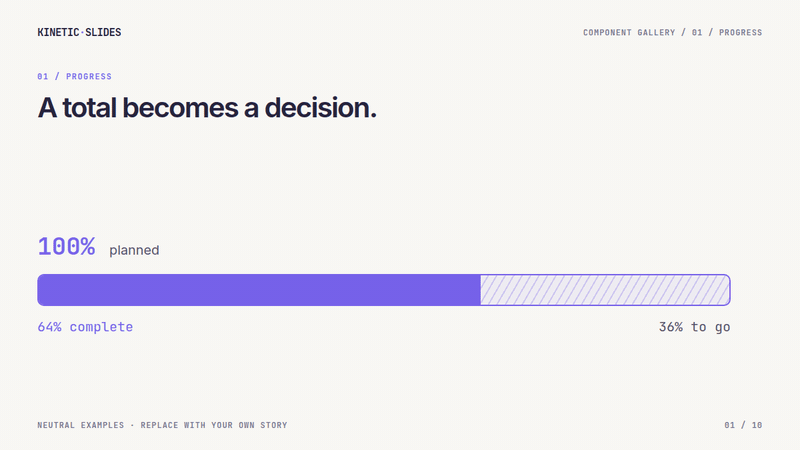
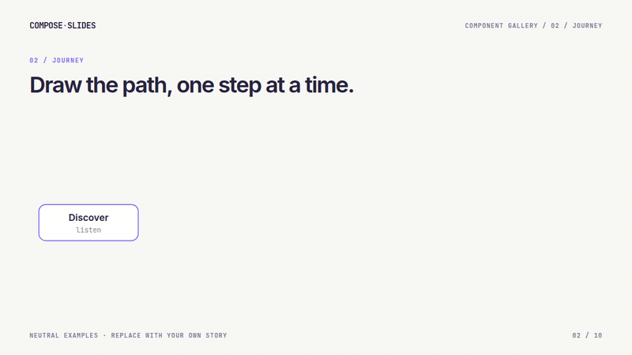
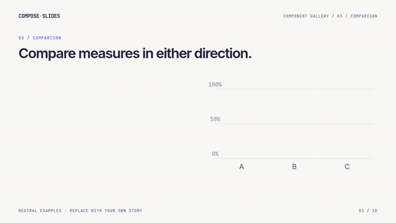
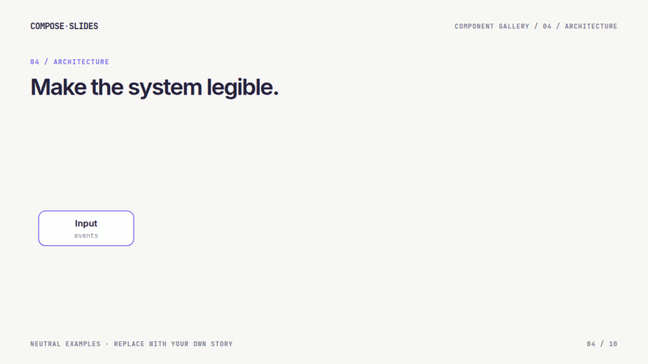
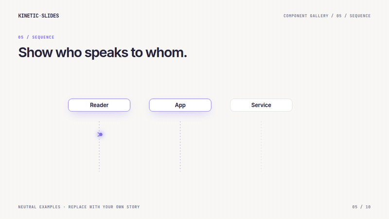
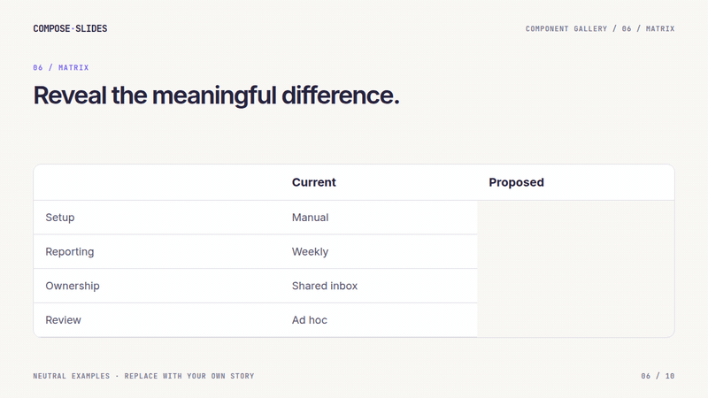
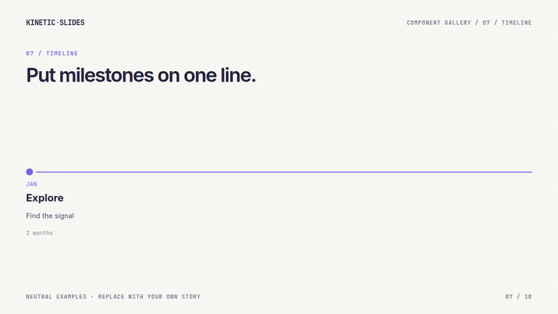
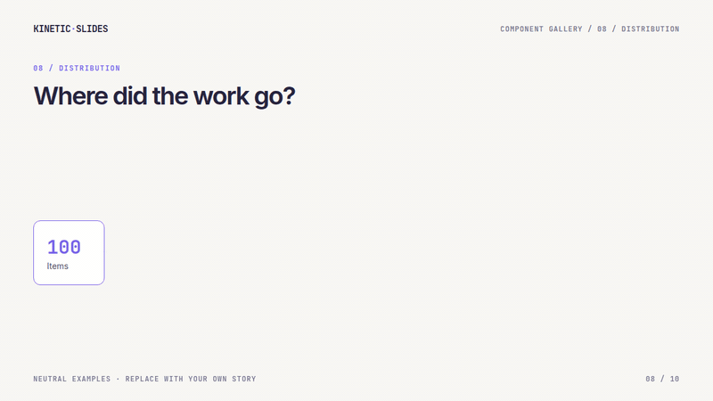
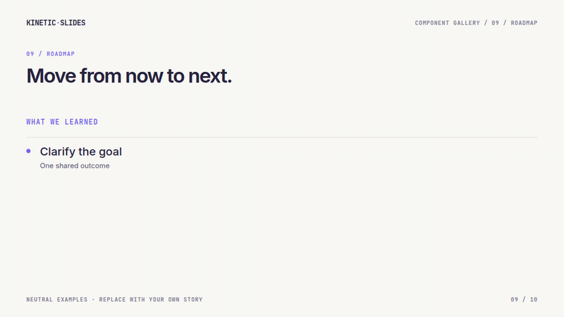
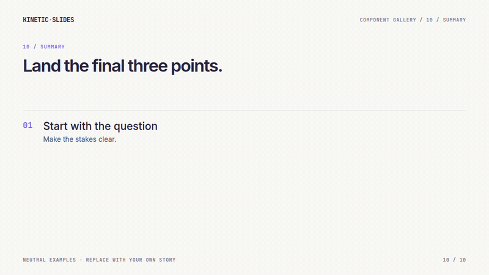

# Kinetic Slides

**Code the moments between your slides.**

Some slides need timing. You want the chart to build while you explain it, the next branch to wait its turn, and your notes to follow on a second screen. Kinetic Slides handles those mechanics in React, then prints every step cleanly.

The screenshots come from *Fieldnotes*, a working demo about two routes through the same neighborhood. The travel times are synthetic.


| 18 minutes → 7 minutes | Three changes, revealed in sequence |
| --- | --- |
|  |  |

## Try the demo

```bash
npm install
npm run dev
```

Open the address Vite prints. Use **→ / Space** to advance a step, **←** to go back, **Home / End** to jump, **F** for fullscreen, and **T** for the on-stage timer. The URL hash records the current scene and step. Open `/?presenter` in a second window for notes; either window can drive the deck. `/?print` renders every step for printing, and `/?print=final` renders the final step of each scene.

## Presenter view

| On your laptop | On your phone |
| --- | --- |
|  |  |

Open `/?presenter` to see the current cue, a live slide preview, the next line, prepared answers, and the timer. On a phone, the preview gives way to a wider cue and thumb-sized controls. The preview is opt-in: pass `showPreview` and load `kinetic-slides/preview.css`.

Notes load when the presenter view opens. For a private deck, `loadProtectedNotes` fetches them from a protected endpoint so they stay out of public static assets.

## Install and use

Kinetic Slides is a React 19 library. In an existing React/Vite app, install the runtime and its peer dependencies:

```bash
npm install kinetic-slides react react-dom motion
```

The first npm release is still pending. Until then, build a local checkout with `npm install && npm run build`, then install that checkout in your app with `npm install /absolute/path/to/kinetic-slides react react-dom motion`.

Create `src/main.tsx`:

```tsx
import { createRoot } from 'react-dom/client';
import {
  Deck, PrintDeck, Reveal, SlideFrame, forceReducedMotion, readPrintOptions,
  type SceneDef, type SceneProps,
} from 'kinetic-slides';
import 'kinetic-slides/theme.css';
import 'kinetic-slides/styles.css';

function Opening({ step }: SceneProps) {
  return <SlideFrame>
    <h1>Your idea</h1>
    <Reveal show={step >= 1}><p>One clear point.</p></Reveal>
  </SlideFrame>;
}

const scenes: SceneDef[] = [
  { id: 'opening', label: 'Opening', window: [0, 1], steps: 2, Component: Opening },
];
const print = readPrintOptions();
if (print) forceReducedMotion();
createRoot(document.getElementById('root')!).render(
  print ? <PrintDeck scenes={scenes} options={print} /> : <Deck scenes={scenes} />,
);
```

Add a `<div id="root"></div>` to your HTML entrypoint. Run your app and press **→** to reveal the second step. Open `/?print` to print all steps. Add scenes to the `scenes` array, then style them with your own CSS after the package styles. See the [getting started guide](docs/getting-started.md) for presenter notes and a fuller setup, the [authoring guide](docs/authoring.md) for composition patterns, and the [API reference](docs/api.md) for the public exports.

## Motion gallery

These ten examples use neutral content and the same components as the [runnable gallery](demo/src/gallery.tsx). Each GIF was recorded from that demo. Copy a component into a scene, pass your own data, and use `step` when the reveal should follow the audience's next keypress. Import the components from `kinetic-slides`.

| [Progress](#progress-split) | [Journey](#drawn-journey) | [Bar charts](#bar-charts) | [Architecture](#system-flow) | [Sequence](#sequence-story) |
| --- | --- | --- | --- | --- |
| [Matrix](#comparison-matrix) | [Timeline](#timeline) | [Distribution](#distribution-flow) | [Roadmap](#roadmap) | [Numbered list](#numbered-list) |

### Progress split

A total fills, then separates into completed and remaining work. Set the labels, number formatter, accent, and duration.



```tsx
<ProgressSplit total={100} used={64} format={n => `${n}%`}
  labels={{ total: 'planned', used: 'complete', remaining: 'to go' }}
  accent="#7662e9" duration={2.4} />
```

### Drawn journey

Nodes and connecting paths reveal in order. Nodes are positioned automatically unless you provide `x` and `y`; `step` lets slide navigation control the drawing.



```tsx
<FlowDiagram step={step} width={980} height={240}
  nodes={[{ id: 'a', label: 'Discover' },
          { id: 'b', label: 'Design' },
          { id: 'c', label: 'Deliver' }]}
  edges={[{ from: 'a', to: 'b' }, { from: 'b', to: 'c', label: 'decision' }]} />
```

### Bar charts

`ComparisonBarChart` supports horizontal and vertical layouts with the same data. Set colors per bar, ticks, number formatting, and animation pacing.



```tsx
const bars = [{ id: 'a', label: 'Draft', value: 38 },
              { id: 'b', label: 'Review', value: 62 },
              { id: 'c', label: 'Ready', value: 84 }];
<ComparisonBarChart bars={bars} max={100} ticks={[0, 50, 100]}
  orientation="vertical" formatValue={n => `${n}%`}
  ariaLabel="Progress by stage" animation={{ duration: 1, stagger: 0.15 }} />
```

### System flow

Use the same diagram API for branching architecture. Nodes can have details and tones; edges can have labels, tones, and dashed strokes.



```tsx
<FlowDiagram step={step} width={1050} height={300}
  nodes={[{ id: 'input', label: 'Input', x: 100, y: 150 },
          { id: 'router', label: 'Router', x: 410, y: 150 },
          { id: 'store', label: 'Store', x: 740, y: 70 }]}
  edges={[{ from: 'input', to: 'router' },
          { from: 'router', to: 'store', label: 'write' }]} />
```

### Sequence story

The high-level wrapper lays out participants and plays the calls. Use `SequenceDiagram` when you need direct control over time, lane positions, self-calls, or streams.



```tsx
<SequenceStory lanes={['Reader', 'App', 'Service']} interval={1.2}
  calls={[{ from: 'Reader', to: 'App', label: 'open report' },
          { from: 'App', to: 'Service', label: 'fetch summary' },
          { from: 'Service', to: 'App', label: 'return data' }]} />
```

### Comparison matrix

Reveal one column cell by cell while the other remains visible.



```tsx
<ComparisonMatrix columns={['Current', 'Proposed']} revealColumn={1}
  rows={[{ label: 'Setup', values: ['Manual', 'Guided'] },
         { label: 'Reporting', values: ['Weekly', 'Live'] }]}
  show={step >= 2} stagger={0.22} />
```

### Timeline

Events are sorted by date, then drawn in order. `active` controls how far the reveal has reached.



```tsx
<Timeline active={step} events={[
  { date: '2026-01', label: 'JAN', title: 'Explore', detail: 'Find the signal' },
  { date: '2026-03', label: 'MAR', title: 'Prototype', detail: 'Make it tangible' },
  { date: '2026-06', label: 'JUN', title: 'Pilot', detail: 'Learn with a team' },
]} />
```

### Distribution flow

An animated distribution turns one total into weighted outcomes. Set the values, colors, labels, and timing.



```tsx
<DistributionFlow totalLabel="Items" outcomes={[
  { label: 'Completed', value: 72, color: '#7662e9' },
  { label: 'In review', value: 19, color: '#55b9a8' },
  { label: 'Deferred', value: 9, color: '#e5a864' },
]} />
```

### Roadmap

The current plan compresses when the next phase appears. `nextAt` sets the transition step; each later step reveals another card.



```tsx
<Roadmap step={step} nextAt={3}
  now={[{ title: 'Clarify the goal' }, { title: 'Simplify the path' },
        { title: 'Test with users' }]}
  next={[{ title: 'Pilot', detail: 'Start with one team' },
         { title: 'Measure', detail: 'Review the result' }]} />
```

### Numbered list

A staggered final summary with configurable numbering, accent, and reveal count.



```tsx
<NumberedList show={step + 1} stagger={0.18} items={[
  { title: 'Start with the question', detail: 'Make the stakes clear.' },
  { title: 'Let the evidence move', detail: 'Reveal only what matters.' },
  { title: 'End with a decision', detail: 'Give the audience a next step.' },
]} />
```

See the [component guide](docs/components.md) for the full prop surface and lower-level building blocks.

## Build a presentation with an AI agent

This repository includes an [agent guide](AGENTS.md) and two task-specific skills. They are also included in the npm package, but agents do not automatically load skills from installed dependencies. Point your agent to these files in a checkout:

| File | What the agent learns |
| --- | --- |
| [Create a presentation](.agents/skills/create-presentation/SKILL.md) | Plan scenes and steps, compose reusable components, write one speaker cue per step, and check navigation, notes, print, and screenshots. |
| [Deploy a presentation](.agents/skills/deploy-presentation/SKILL.md) | Set up Cloudflare or Vercel, including the optional WebSocket relay and private notes. |

Start with a new React/Vite app and the [getting started guide](docs/getting-started.md). The neutral [`demo/src`](demo/src) shows scenes, notes, and a theme working together. Give an agent a request like this:

```text
Read AGENTS.md and .agents/skills/create-presentation/SKILL.md in the
Kinetic Slides repository. Build a presentation for [audience] about [topic]
in a separate React/Vite app using kinetic-slides. Use the demo as a reference.
Create reusable scene components, define each reveal as a step, and write
presenter notes with one cue per step. Keep my content and assets in the new
app. Check the deck, presenter view at desktop and phone widths, and print
mode; then build, typecheck, lint, and show me representative screenshots.
```

When the deck is ready to host, ask the agent to follow the [deployment skill](.agents/skills/deploy-presentation/SKILL.md) and name Cloudflare or Vercel as the target.

## Components

The library includes more than the deck shell. The [motion gallery](#motion-gallery) shows ten slide-level patterns with code and GIFs. [The component guide](docs/components.md) shows how to combine headings, cards, badges, icon tiles, callouts, diagram nodes and paths, animated counts, staggered items, a data-driven comparison chart, and a timed sequence diagram. These are the same visual building blocks used by the presentation this framework was extracted from. Content is passed as props; the library keeps no client-specific copy or data.

| Build a slide | Guide attention | Show data |
| --- | --- | --- |
| `SlideFrame`, `SlideHeading`, `SlideCard`, `MotionCard`, `IconTile`, `Badge`, `QuoteCallout` | `Reveal`, `StepSequence`, `StaggeredItem`, `DrawPath`, `DiagramNode`, `FlowDiagram`, `ComparisonMatrix`, `Timeline`, `Roadmap`, `NumberedList` | `CountUp`, `ProgressSplit`, `ComparisonBarChart`, `SequenceStory`, `SequenceDiagram`, `DistributionFlow` |

## Live sync and WebSockets

Without a control key, the deck and notes use `BroadcastChannel` for same-browser communication. With a key, each opens a WebSocket at `/ws?k=…`. The deck owns the current position and timer; the presenter sends commands or raw keys back, so scene-specific keyboard shortcuts still work. The client reconnects after network loss or phone sleep and sends a hello message to recover the latest state.

For cross-device use, `src/cloudflare/relay.ts` is a Cloudflare Durable Object relay. It authenticates before upgrading the socket, relays messages between peers, stores the last position for late joiners, and answers heartbeat pings without waking the room. `demo/worker.ts` shows the protected endpoint. The demo notes are intentionally public for static hosting; a private deck must keep its notes out of client imports. Pair a browser at `/?pair`; the key is kept in local storage and removed from the URL after entry. Use a unique, high-entropy `CONTROL_KEY` secret for each deck. See [sync architecture](docs/sync.md) and the [deployment skill](.agents/skills/deploy-presentation/SKILL.md).

## Project map

| Path | Purpose |
| --- | --- |
| `src/runtime` | Deck shell, presenter, timer, print, sync, motion |
| `src/cloudflare` | Optional authenticated WebSocket relay |
| `src/styles` | Default design tokens |
| `demo/src` | Neutral example scenes, notes, visual theme |
| `docs/images` | Screenshots captured from the running demo |
| `.agents/skills` | Agent workflows for authoring and deployment |

## Development

```bash
npm run build       # library JS, declarations and CSS
npm run demo:build  # production demo
npm run typecheck
npm run lint
npm run test:smoke   # while the demo dev server is running
```

Run `npx playwright install chromium` once, then `node scripts/capture-readme.mjs` and `node scripts/capture-gallery.mjs` while the demo server is running to refresh the README screenshots and GIFs. You can set `CHROMIUM_PATH` to an existing Chrome or Chromium binary instead. Contributions are welcome; keep the runtime content-neutral and add a focused demo example for new public APIs. Maintainers can follow the [npm publishing guide](docs/publishing.md). Licensed under [MIT](LICENSE).
