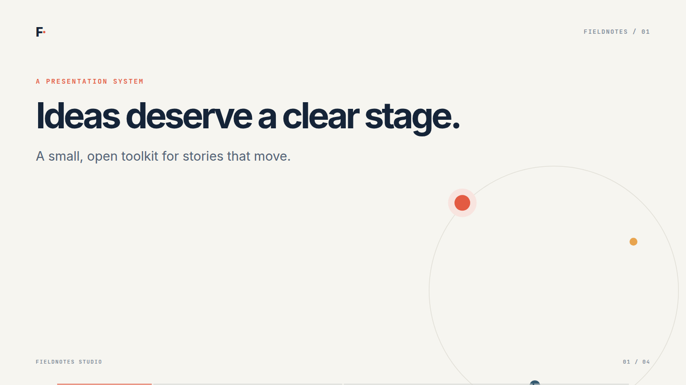
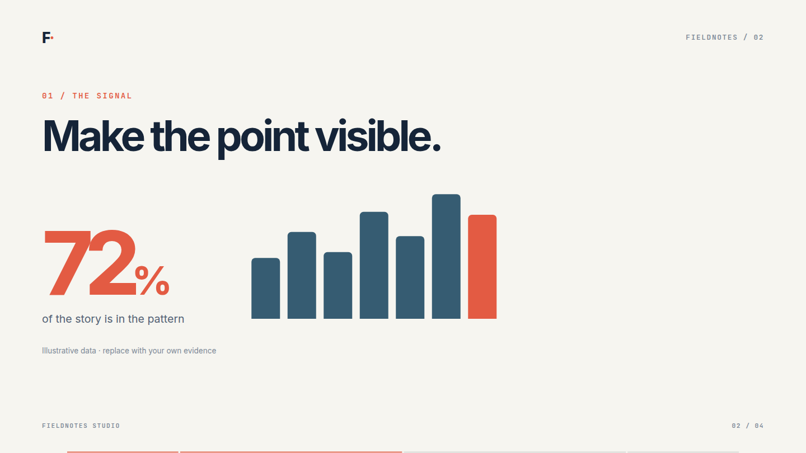
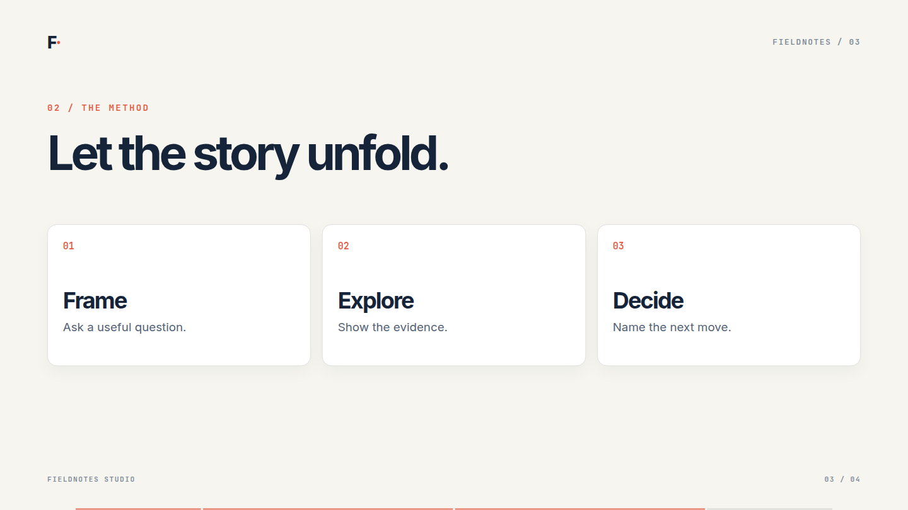
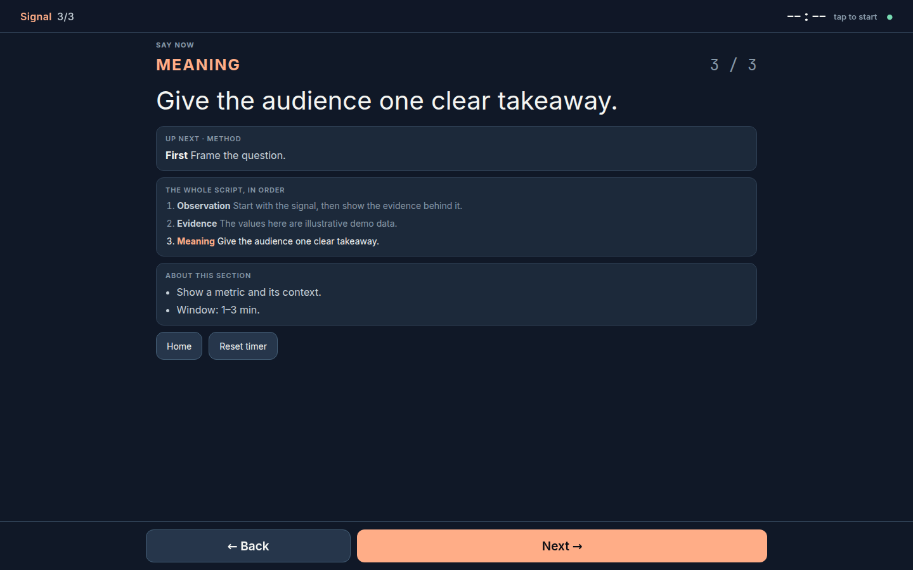
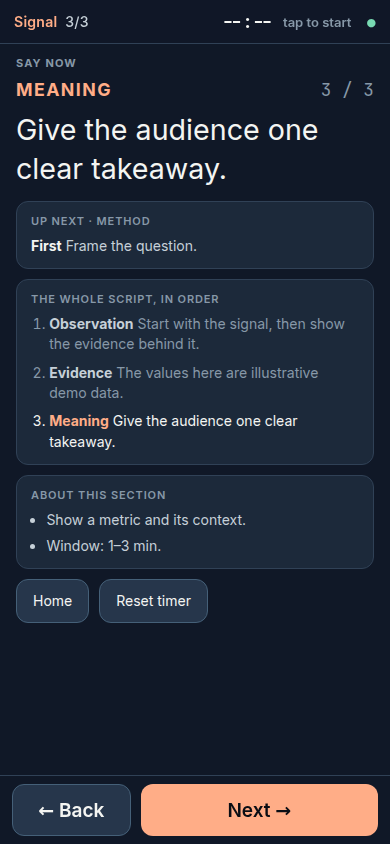

# Compose Slides

**Presentations that feel like a product, built from small React scenes.**

Compose Slides supplies a fixed 1920 × 1080 stage, step-based navigation, motion primitives, presenter notes, a timer, print/PDF mode, and optional live control across devices. The included *Fieldnotes* presentation is neutral example content you can replace.



| Data, clearly framed | A story in steps |
| --- | --- |
|  |  |

## Try the demo

```bash
npm install
npm run dev
```

Open the address Vite prints. Use **→ / Space** to advance a step, **←** to go back, **Home / End** to jump, **F** for fullscreen, and **T** for the on-stage timer. The URL hash records the current scene and step. Open `/?presenter` in a second window for notes; either window can drive the deck. `/?print` renders every step for printing, and `/?print=final` renders the final step of each scene.

## Presenter view

| Desktop notes | Phone notes |
| --- | --- |
|  |  |

The presenter view shows the current spoken cue, next cue, section timing, a timer, likely questions, and navigation. Notes are supplied by your presentation. The demo loads them only when the presenter view opens. For a private production deck, `loadProtectedNotes` fetches them from a key-protected endpoint so they never enter public static assets.

## Install and use

Compose Slides is a React 19 library. In an existing React/Vite app, install the runtime and its peer dependencies:

```bash
npm install compose-slides react react-dom motion
```

The first npm release is still pending. Until then, build a local checkout with `npm install && npm run build`, then install that checkout in your app with `npm install /absolute/path/to/Compose-Slides react react-dom motion`.

Create `src/main.tsx`:

```tsx
import { createRoot } from 'react-dom/client';
import {
  Deck, PrintDeck, Reveal, SlideFrame, forceReducedMotion, readPrintOptions,
  type SceneDef, type SceneProps,
} from 'compose-slides';
import 'compose-slides/theme.css';
import 'compose-slides/styles.css';

function Opening({ step }: SceneProps) {
  return <SlideFrame>
    <h1>Your idea</h1>
    <Reveal show={step >= 1}><p>One clear point.</p></Reveal>
  </SlideFrame>;
}

const scenes: SceneDef[] = [
  { id: 'opening', label: 'Opening', window: [0, 1], steps: 2, Component: Opening },
];
const print = readPrintOptions();
if (print) forceReducedMotion();
createRoot(document.getElementById('root')!).render(
  print ? <PrintDeck scenes={scenes} options={print} /> : <Deck scenes={scenes} />,
);
```

Add a `<div id="root"></div>` to your HTML entrypoint. Run your app and press **→** to reveal the second step. Open `/?print` to print all steps. Add scenes to the `scenes` array, then style them with your own CSS after the package styles. See the [getting started guide](docs/getting-started.md) for presenter notes and a fuller setup, the [authoring guide](docs/authoring.md) for composition patterns, and the [API reference](docs/api.md) for the public exports.

## Live sync and WebSockets

Without a control key, the deck and notes use `BroadcastChannel` for same-browser communication. With a key, each opens a WebSocket at `/ws?k=…`. The deck owns the current position and timer; the presenter sends commands or raw keys back, so scene-specific keyboard shortcuts still work. The client reconnects after network loss or phone sleep and sends a hello message to recover the latest state.

For cross-device use, `src/cloudflare/relay.ts` is a Cloudflare Durable Object relay. It authenticates before upgrading the socket, relays messages between peers, stores the last position for late joiners, and answers heartbeat pings without waking the room. `demo/worker.ts` shows the protected endpoint. The demo notes are intentionally public for static hosting; a private deck must keep its notes out of client imports. Pair a browser at `/?pair`; the key is kept in local storage and removed from the URL after entry. Use a unique, high-entropy `CONTROL_KEY` secret for each deck. See [sync architecture](docs/sync.md) and the [deployment skill](.agents/skills/deploy-presentation/SKILL.md).

## Project map

| Path | Purpose |
| --- | --- |
| `src/runtime` | Deck shell, presenter, timer, print, sync, motion |
| `src/cloudflare` | Optional authenticated WebSocket relay |
| `src/styles` | Default design tokens |
| `demo/src` | Neutral example scenes, notes, visual theme |
| `docs/images` | Screenshots captured from the running demo |
| `.agents/skills` | Agent workflows for authoring and deployment |

## Development

```bash
npm run build       # library JS, declarations and CSS
npm run demo:build  # production demo
npm run typecheck
npm run lint
npm run test:smoke   # while the demo dev server is running
```

Run `npx playwright install chromium` once, then `node scripts/capture-readme.mjs` while the demo server is running to refresh the README screenshots. You can set `CHROMIUM_PATH` to an existing Chrome or Chromium binary instead. Contributions are welcome; keep the runtime content-neutral and add a focused demo example for new public APIs. Maintainers can follow the [npm publishing guide](docs/publishing.md). Licensed under [MIT](LICENSE).
