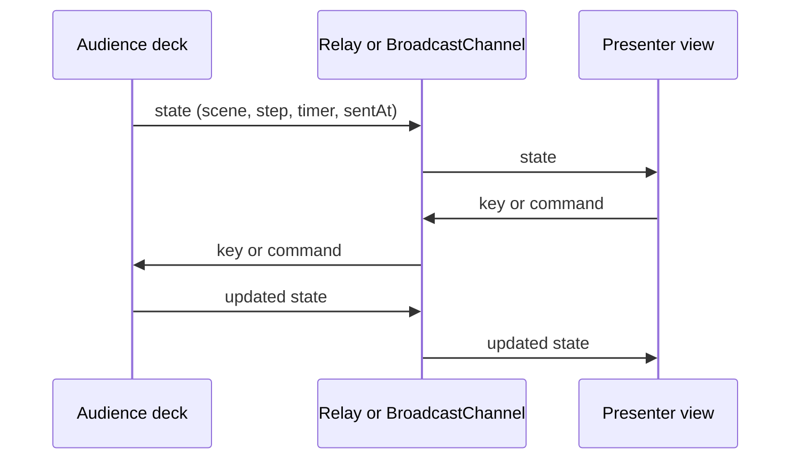

# Sync architecture

The deck is the authority for position and timer. The presenter never advances itself optimistically. It asks the deck to advance, then waits for a state update. A `hello` message requests a snapshot when a presenter connects late. The Cloudflare Durable Object stores the last state and returns it to the new socket.

`BroadcastChannel` works across windows of one browser origin and needs no server. WebSocket mode is selected when the browser has a control key. Both peers connect to the same `/ws` endpoint; the Worker checks the key before upgrading. The relay accepts only known message types and caps message size. It stores the most recent state, not a history of notes or commands.

The presenter computes elapsed time from the deck's `startedAt`, `pausedAt`, and `sentAt`, then advances it using time since receipt. This avoids trusting clocks on two devices to agree. The WebSocket client retries with backoff, reconnects when a sleeping phone wakes, and sends a heartbeat. The Durable Object answers heartbeats automatically.

`/api/notes` is separate from `/ws`. A production Worker can serve notes only after the same key check. To keep notes private, use a server-only notes file and confirm its text is absent from built assets. The demo deliberately includes public example notes for static hosting. A static host can support a same-browser presenter by lazy-loading public notes, as the demo does. For private notes or cross-device control, deploy the Worker.
